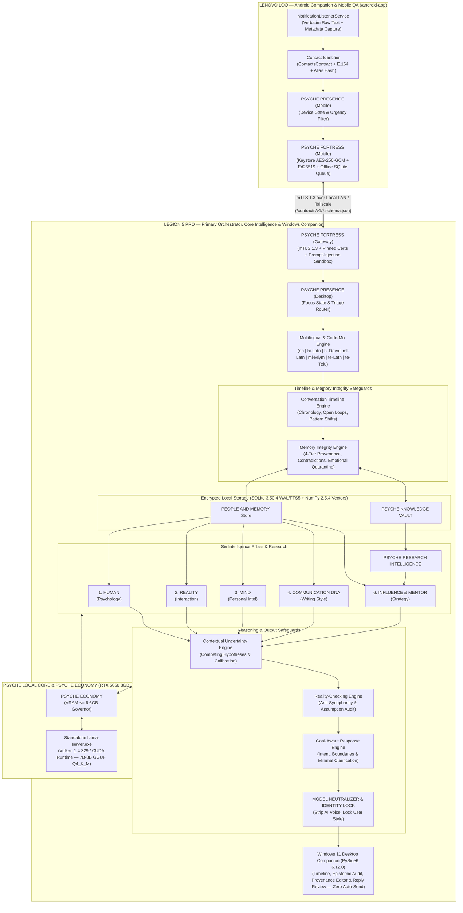

# PSYCHE AI — Master System Architecture

> **Status**: Approved Baseline (`v1.0.0`)  
> **Repository**: `https://github.com/sidharthkurup-coder/PSYCHE-AI.git` (Private Single Source of Truth)  
> **Primary Orchestrator**: Lenovo Legion 5 Pro (Windows 11, Ryzen 7 260, RTX 5050 8 GB VRAM, 16 GB DDR5)  
> **Secondary Parallel Machine**: Lenovo LOQ (Ryzen 7, 16 GB RAM — Android & Multilingual QA Domain)

---

## 1. Product Overview & Architectural Philosophy

**PSYCHE AI** is a private, local-first personal intelligence system for contextual communication analysis, psychological reasoning, multilingual understanding, relationship memory, and strategic communication assistance.

### Core Architectural Invariants
1. **Local-First Sovereignty (`PSYCHE LOCAL CORE`)**: All notification ingestion, contact resolution, memory storage, psychological/contextual reasoning, and reply generation execute locally by default. Private messages are never transmitted to external AI providers without explicit, per-request user authorization and PII pseudonymization.
2. **Zero Automatic Message Sending**: PSYCHE AI is a decision-support and communication intelligence partner. It **never** automatically transmits messages on behalf of the user. Every recommendation terminates in a mandatory **User Review Gate**.
3. **Epistemic Honesty & Anti-Sycophancy**: The system strictly separates verified facts, user reports, behavioral observations, and AI hypotheses. It actively challenges unsupported assumptions from both the user and the AI (`Reality-Checking Engine`), preserves the user's independent thinking (`MIND`), and explicitly permits `INCONCLUSIVE` conclusions when evidence is insufficient (`Contextual Uncertainty Engine`).
4. **Immutable Multilingual Fidelity**: Original messages across **English (`en`)**, **Hindi (`hi-Latn`, `hi-Deva`)**, **Malayalam (`ml-Latn`, `ml-Mlym`)**, and **Telugu (`te-Latn`, `te-Telu`)**—including natural intra-message code-mixing—are preserved verbatim byte-for-byte (`SHA-256` verified) and never overwritten by translations.

---

## 2. The Six Core Intelligence Pillars

| Pillar | Domain | Architectural Responsibility | Owned Module |
| :--- | :--- | :--- | :--- |
| **1. `HUMAN`** | Psychology Intelligence | Decodes emotional states, attachment/defense patterns, cognitive load, stress indicators, and interpersonal power dynamics in incoming messages and user drafts. | `/core/pillars/human/` |
| **2. `REALITY`** | Message & Interaction Intelligence | Analyzes pragmatic meaning vs. literal phrasing, detects subtext, sarcasm, colloquial idioms, urgency, and situational grounding. | `/core/pillars/reality/` |
| **3. `MIND`** | Personal Intelligence | Models the user's internal values, long-term objectives, recurring triggers, decision history, and cognitive blind spots while preserving **independent thinking**. | `/core/pillars/mind/` |
| **4. `COMMUNICATION DNA`** | Personal Writing Intelligence | Captures the user's authentic stylistic fingerprint per contact and language mode (lexicon, sentence length, punctuation, code-mixing ratios, transliteration spelling habits, tone). | `/core/pillars/comm_dna/` |
| **5. `PEOPLE AND MEMORY`** | Relationship Intelligence | Maintains the canonical cross-script entity graph, relationship closeness tiers, trust levels, historical commitments, boundaries, and provenance-backed memories. | `/core/pillars/people_memory/` |
| **6. `INFLUENCE AND MENTOR`** | Communication Strategy & Personal Development | Formulates strategic communication options (de-escalation, boundary enforcement, persuasion, empathetic alignment) and provides developmental coaching to the user. | `/core/pillars/influence_mentor/` |

---

## 3. The Eight Supporting Subsystems

1. **`PSYCHE KNOWLEDGE VAULT` (`/core/subsystems/knowledge_vault/`)**: Encrypted local store of user-authored notes, personal documents, domain references, and verified user facts.
2. **`PSYCHE RESEARCH INTELLIGENCE` (`/core/subsystems/research_intel/`)**: Multi-hop analytical retrieval and synthesis engine that cross-references `PEOPLE AND MEMORY`, `Conversation Timeline Engine`, and `PSYCHE KNOWLEDGE VAULT` to answer complex longitudinal questions.
3. **`PSYCHE LOCAL CORE` (`/core/subsystems/local_core/`)**: Local execution kernel managing background daemon lifecycle, hardware telemetry, offline state machine, and deterministic storage persistence.
4. **`MODEL NEUTRALIZER AND IDENTITY LOCK` (`/core/subsystems/model_neutralizer/`)**: Prompt-conditioning and output verification filter that strips generic LLM boilerplate, preachy moralizing, and artificial phrasing, locking output strictly to the user's `COMMUNICATION DNA`.
5. **`PSYCHE ECONOMY` (`/core/subsystems/economy/`)**: Compute, VRAM (`<= 6,600 MiB` on RTX 5050), RAM (`<= 2,500 MiB`), latency, and token governor managing model residency and gating any opt-in external provider calls.
6. **`PSYCHE PRESENCE` (`/core/subsystems/presence/`)**: Cross-device ambient awareness engine tracking user activity across Android and Windows, focus/DND state, and notification urgency triage.
7. **`PSYCHE FORTRESS` (`/core/subsystems/fortress/`)**: Zero-trust security subsystem enforcing mTLS 1.3 + QR/SAS pairing, DPAPI/Android Keystore encryption at rest, untrusted message sandboxing (prompt-injection firewall), and instant Panic Lock.
8. **`Functionality and Quality Assurance` (`/tests/`, `/eval-multilingual/`)**: Continuous verification harness validating JSON schema contracts, 7-mode multilingual fidelity, memory integrity recovery, and anti-sycophancy compliance.

---

## 4. The Five Mandatory Engineering Safeguards

### A. Contextual Uncertainty Engine (`/core/safeguards/uncertainty/`)
- Separates objective facts (`VERIFIED_FACT`, `OBSERVATION`) from subjective interpretations (`AI_HYPOTHESIS`).
- Generates $\ge 2$ plausible alternative explanations whenever interpersonal intent or subtext is ambiguous.
- Surfaces contradictory evidence from historical memories or timeline events.
- Outputs calibrated confidence scores $\in [0.00, 1.00]$ and explicitly emits `INCONCLUSIVE` when confidence falls below threshold ($< 0.45$).

### B. Memory Integrity Engine (`/core/safeguards/memory_integrity/`)
- Enforces 4-tier epistemic classification: `VERIFIED_FACT`, `USER_REPORT`, `OBSERVATION`, `AI_HYPOTHESIS`.
- Maintains immutable provenance links (`source_event_ids`, `captured_at_utc`, `extractor_model_id`, `evidence_quote`).
- Detects contradictions against existing memories and records them in `memory_contradictions`.
- Supports non-destructive corrections, versioned superseding chains (`supersedes_memory_id`), crash recovery (SQLite WAL + snapshots), and hard/soft deletion.
- **Emotional Quarantine**: Tags high-arousal temporary emotional reactions from the user as `EMOTIONAL_TRANSIENT` with a mandatory cool-down TTL (default 72 hours), preventing acute frustration or venting from corrupting permanent `PEOPLE` traits or `MIND` models.

### C. Conversation Timeline Engine (`/core/safeguards/timeline/`)
- Reconstructs chronological interaction sequences across notifications and user actions with clock-skew normalization.
- Tracks **Open Loops**: unanswered inbound questions, pending outbound questions, and unresolved commitments/situations.
- Computes rolling communication pattern metrics (reply latency baseline, initiation ratio, message length, language/script shift anomalies).
- Strictly separates `OBSERVED_EVENT` (e.g., message received at timestamp $T$) from `INFERRED_EVENT` (e.g., assumed reason for delay).

### D. Goal-Aware Response Engine (`/core/safeguards/goal_response/`)
- Aligns reply recommendations with the user's explicit communication goal, relationship boundary rules, and `COMMUNICATION DNA` profile for the target recipient.
- Minimizes cognitive friction by asking the user for clarification **only** when missing context would materially alter the strategic outcome.

### E. Reality-Checking Engine (`/core/safeguards/reality_check/`)
- Audits both user assumptions and AI draft inferences against factual timeline and memory records.
- Explicitly distinguishes emotional reactions/feelings from factual conclusions.
- Enforces **Anti-Sycophancy & Independent-Thinking Preservation**: refuses to automatically validate unsupported user assumptions when objective evidence is absent or contradictory.

---

## 5. End-to-End System Topology



---

## 6. Multilingual Processing Architecture (`REQ-LANG-01`)

### 6.1 Strictly Authorized Language & Script Scope
Only the following **seven language/script modes** and their **natural intra-message combinations** are supported:
1. **`en`** — English (Latin script)
2. **`hi-Latn`** — Hindi typed in English letters (Romanized Hindi / Hinglish)
3. **`hi-Deva`** — Hindi typed in Devanagari (`U+0900–U+097F`)
4. **`ml-Latn`** — Malayalam typed in English letters (Romanized Malayalam / Manglish)
5. **`ml-Mlym`** — Malayalam typed in Malayalam script (`U+0D00–U+0D7F`)
6. **`te-Latn`** — Telugu typed in English letters (Romanized Telugu / Tenglish)
7. **`te-Telu`** — Telugu typed in Telugu script (`U+0C00–U+0C7F`)

*Any other language detected is tagged `out_of_scope` without silent translation or unapproved expansion.*

### 6.2 Four-Stage Non-Destructive Language Pipeline
1. **Immutable Capture**: Raw message text is stored verbatim in `raw_events.raw_text_immutable` with a `SHA-256` integrity hash.
2. **Token-Span Script & Code-Mix Identification**: Segments intra-message code-switching (e.g., `ml-Latn` + `en`, `te-Latn` + `en`, `hi-Latn` + `hi-Deva`) at the token/clause level.
3. **Transliteration & Phonetic Anchor Generation (Search Index Only)**: Maps phonetic spelling variations in `hi-Latn`, `ml-Latn`, and `te-Latn` (e.g., Manglish `evideya`/`evdeya`/`evide`, Hinglish `kya`/`kyaa`, Tenglish `chestunnav`/`chesthunav`) to canonical phonetic anchors for `FTS5` and `PEOPLE` alias matching without altering the original text.
4. **Pragmatic, Idiom, Sarcasm & Honorific Decoding (`REALITY` + `COMMUNICATION DNA`)**: Evaluates colloquial expressions, politeness/intimacy markers (`nee`/`ningal`, `tu`/`tum`/`aap`, `nuvvu`/`meeru`, `chechi`/`chettan`, `garu`, `bhai`), and sarcasm in context, and mirrors the user's exact code-mixing ratio per recipient when drafting responses.

---

## 7. Verified Hardware & Technology Stack Decisions

All technology selections have been validated against the inspected hardware and software environment:

| Layer | Approved Technology | Compatibility & Engineering Justification |
| :--- | :--- | :--- |
| **Android Companion (LOQ)** | **Native Kotlin + Jetpack Compose** | Direct access to `NotificationListenerService`, `ContactsContract`, and Android Hardware `Keystore` without fragile cross-platform background service bridges. |
| **Windows Companion UI (Legion)** | **PySide6 `6.12.0` (Qt6 + WebEngine)** | Verified pre-installed on Legion 5 Pro (`Python 3.14.5`). Avoids Rust/MSVC build dependencies (`Tauri`) and Chromium RAM bloat (`Electron`). |
| **Local Service Backend (Legion)** | **Starlette `1.8.0` + Uvicorn `0.54.0` + Websockets `17.2` + `jsonschema 4.26.0`** | Verified pre-installed on `Python 3.14.5`. Provides async HTTPS/mTLS + WebSocket ingestion and strict JSON schema validation out of the box. |
| **Local AI Inference Runtime** | **Standalone `llama-server.exe` (`llama.cpp` official prebuilt binary)** | Decouples LLM inference from `Python 3.14.5` (`cp314`) C-extension wheel incompatibilities. Communicates over localhost HTTP (`127.0.0.1:8089`) with grammar-constrained JSON output. |
| **GPU Compute Acceleration** | **Vulkan `1.4.329` (Active on RTX 5050 `GPU0`) + Bundled CUDA 12.x Runtime DLLs** | `vulkaninfo.exe` verified Vulkan `1.4.329` active on RTX 5050 (`596.49` driver) without requiring a 6 GB CUDA Toolkit (`nvcc`) installation. |
| **Local Model & Quantization** | **7B–8B Instruct GGUF (`Q4_K_M`, `~4.8 GB` weights + `~0.7 GB` `8k` KV cache)** | Fits comfortably inside the `6,600 MiB` VRAM ceiling on the `8,151 MiB` RTX 5050 without spilling into system RAM. |
| **Database & Vector Retrieval** | **SQLite `3.50.4` (`WAL` + `FTS5`) + Memory-Mapped `NumPy 2.5.4` (`float16`)** | Verified built into `Python 3.14.5`. Achieves `< 4 ms` exact cosine similarity search up to 100k memories (`~153 MB` RAM) with zero C++ extension build failures. |
| **Encryption & Key Custody** | **Windows DPAPI (`crypt32.dll`) + AES-256-GCM; Android Hardware Keystore** | Native hardware/OS-bound key protection on both platforms without plaintext secrets on disk. |

---

## 8. Two-Laptop Ownership & Repository Governance

### 8.1 Monorepo Directory Ownership (`PSYCHE-AI`)
```text
PSYCHE-AI/
├── ARCHITECTURE.md                  # [Legion 5 Pro] Master System Architecture
├── REQUIREMENTS.md                  # [Legion 5 Pro] Requirements & Traceability Matrix
├── DATA_MODEL.md                    # [Legion 5 Pro] Database, Provenance & Vector Schema
├── SECURITY.md                      # [Legion 5 Pro] PSYCHE FORTRESS Threat Model & Security Spec
├── contracts/
│   └── v1/                          # [Legion 5 Pro Owns / Lenovo LOQ Consumes] Shared JSON Schemas & API Spec
├── core/                            # [Legion 5 Pro] 6 Pillars, 8 Subsystems, 5 Safeguards, Multilingual Engine
├── local-ai/                        # [Legion 5 Pro] llama.cpp Adapter, PSYCHE ECONOMY Governor, Benchmarks
├── windows-companion/               # [Legion 5 Pro] PySide6 Desktop UI & mTLS Ingest Gateway
├── android-app/                     # [Lenovo LOQ] Kotlin Android App, NotificationListener, Contacts, Sync
├── eval-multilingual/               # [Shared] Golden Multilingual Test Corpora (LOQ: Mobile QA, Legion: LLM Eval)
├── tests/                           # [Shared] Contract Conformance & Integration Tests
└── docs/
    └── sync/                        # [Shared Per-File] LEGION_STATUS.md & LOQ_STATUS.md
```

### 8.2 Git Branching & Synchronization Rules
1. **`main`**: Protected integration branch managed by the **Legion 5 Pro Principal Orchestrator**.
2. **`contracts/v1`**: Shared API contracts and schema changes locked prior to parallel feature work.
3. **`legion/*`**: Feature branches authored on the Legion 5 Pro using isolated Git worktrees (`git worktree`).
4. **`loq/*`**: Feature branches authored on the Lenovo LOQ (`loq/android-foundation`, `loq/notification-listener`, `loq/contact-resolver`, `loq/multilingual-qa`).
5. **Verification Rule**: Neither machine assumes work on the other machine is complete until committed, pushed to `origin`, and verified via `git fetch --all` and passing contract tests.

---

## 9. Multi-Agent Coordination Plan (Legion 5 Pro)

1. **`ARCHITECTURE AGENT`**: Owns `ARCHITECTURE.md`, `REQUIREMENTS.md`, `DATA_MODEL.md`, and `/contracts/v1/`.
2. **`INTELLIGENCE AGENT`**: Owns Pillars `HUMAN`, `REALITY`, `MIND`, `COMMUNICATION DNA`, `INFLUENCE AND MENTOR`, `PSYCHE RESEARCH INTELLIGENCE`, `MODEL NEUTRALIZER AND IDENTITY LOCK`, and Safeguards `Contextual Uncertainty Engine`, `Conversation Timeline Engine`, `Goal-Aware Response Engine`, and `Reality-Checking Engine`.
3. **`MEMORY AGENT`**: Owns Pillar `PEOPLE AND MEMORY`, `PSYCHE KNOWLEDGE VAULT`, and Safeguard `Memory Integrity Engine` (provenance, contradiction detection, emotional quarantine, revisioning, recovery).
4. **`LOCAL AI AGENT`**: Owns `PSYCHE LOCAL CORE`, `PSYCHE ECONOMY`, `llama-server` lifecycle, RTX 5050 VRAM governance, and 7-mode multilingual model benchmarks.
5. **`WINDOWS AGENT`**: Owns `windows-companion/` (`PySide6` desktop UI, `PSYCHE PRESENCE` desktop integration, and local mTLS gateway).
6. **`SECURITY AGENT`**: Owns `SECURITY.md` and `PSYCHE FORTRESS` (pairing, encryption, prompt-injection red-teaming, secret-leak verification).
7. **`QA AGENT`**: Owns `Functionality and Quality Assurance`, contract conformance tests, vertical slice verification, and independent code reviews.

---

## 10. First Working Vertical Slice (`REQ-VSLICE-01`)

The mandatory first end-to-end milestone proves the complete loop without mock screens or placeholder logic:
1. **Android Notification Capture (LOQ)**: `NotificationListenerService` captures a real incoming message (across any of the 7 language modes or code-mixed text) while preserving raw text verbatim.
2. **Contact Identification (LOQ $\rightarrow$ Legion)**: Resolves sender against `ContactsContract` and `PEOPLE AND MEMORY` cross-script alias graph (or flags ambiguity).
3. **Secure mTLS Sync**: Transmits signed `NotificationIngestRequest` (`contracts/v1/notification_ingest.schema.json`) to Windows Companion over TLS 1.3.
4. **Timeline & Memory Retrieval (Legion)**: Updates `Conversation Timeline Engine` (open loops, cadence) and retrieves provenance-tagged memories + contradictions via `Memory Integrity Engine`.
5. **Multilingual & 6-Pillar Contextual Reasoning (Legion)**: Executes language understanding, 6-pillar analysis, `Contextual Uncertainty Engine`, and `Reality-Checking Engine` on the RTX 5050.
6. **Personalized Reply Recommendation & User Review (Legion)**: Synthesizes reply options via `Goal-Aware Response Engine` + `COMMUNICATION DNA` + `MODEL NEUTRALIZER AND IDENTITY LOCK` and renders the complete evidence, uncertainty audit, and editable drafts in the Windows Desktop Companion for **user review**.
