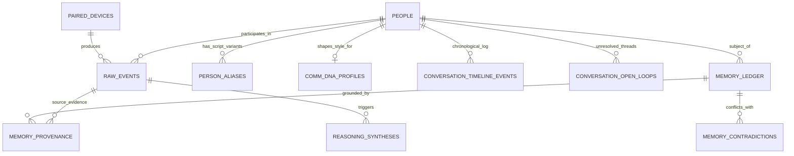

# PSYCHE AI — Master Data Model, Provenance & Retrieval Architecture

> **Status**: Approved Baseline (`v1.0.0`)  
> **Primary Storage Engine (Legion 5 Pro)**: SQLite `3.50.4` (`WAL` mode, `ENABLE_FTS5`, `ENABLE_RTREE`) + Memory-Mapped `NumPy 2.5.4` Vector Store + Windows DPAPI `AES-256-GCM` Field/Envelope Encryption  
> **Mobile Queue Engine (Lenovo LOQ)**: Android SQLite (`Room` / `SQLCipher`) backed by Android Hardware `Keystore`

---

## 1. Core Data Modeling Principles

1. **Immutable Verbatim Ingestion**: Every raw communication signal is stored once in `raw_events` with its original UTF-8 text (`raw_text_immutable`) and `SHA-256` hash. Downstream normalization, transliteration indexing, or reasoning **never** mutates `raw_events`.
2. **Four-Tier Epistemic Separation (`Memory Integrity Engine`)**: Every memory statement in `memory_ledger` is strictly typed as one of:
   - `VERIFIED_FACT` — Directly observed, cryptographically signed, or objectively verified event/fact.
   - `USER_REPORT` — A statement reported by the user about a person or situation (stored as the user's perspective until corroborated).
   - `OBSERVATION` — A quantitative or timeline pattern computed deterministically from `raw_events` (e.g., reply latency shift).
   - `AI_HYPOTHESIS` — A psychological or contextual interpretation generated by an intelligence pillar (`HUMAN`, `REALITY`, `MIND`, `INFLUENCE AND MENTOR`).
3. **Emotional Quarantine**: Memories extracted during high emotional arousal or acute venting are assigned `quarantine_status = 'EMOTIONAL_TRANSIENT'` with a `quarantine_expires_utc` timestamp, blocking them from mutating permanent `PEOPLE` relationship traits or `MIND` core models unless re-confirmed after cool-down.
4. **Non-Destructive Versioning & Correction**: Updating or correcting a memory never overwrites history in place; it inserts a new row with `revision_num = prior.revision_num + 1` and `supersedes_memory_id = prior.memory_id`, marking the prior row `status = 'SUPERSEDED'`.

---

## 2. Entity-Relationship Diagram



---

## 3. Relational Schema Specification (SQLite `3.50.4`)

```sql
PRAGMA journal_mode = WAL;
PRAGMA synchronous = FULL;
PRAGMA foreign_keys = ON;

-- 1. Paired Companion Devices (PSYCHE FORTRESS)
CREATE TABLE paired_devices (
    device_id TEXT PRIMARY KEY,                  -- Unique Android device fingerprint UUID
    device_name TEXT NOT NULL,                   -- e.g., "Sidharth Android Companion"
    ed25519_public_key_b64 TEXT NOT NULL,        -- Pinned Ed25519 verification key
    tls_cert_sha256_pin TEXT NOT NULL,           -- Pinned mTLS client certificate fingerprint
    paired_at_utc TEXT NOT NULL,                 -- ISO-8601 UTC
    last_seen_at_utc TEXT,
    trust_status TEXT NOT NULL CHECK (trust_status IN ('ACTIVE', 'REVOKED', 'LOCKED'))
);

-- 2. Immutable Raw Communication Events
CREATE TABLE raw_events (
    event_id TEXT PRIMARY KEY,                   -- Monotonic UUIDv7 generated at capture
    device_id TEXT NOT NULL REFERENCES paired_devices(device_id),
    package_name TEXT NOT NULL,                  -- e.g., "com.whatsapp", "com.google.android.apps.messaging"
    notification_category TEXT NOT NULL,         -- e.g., "msg", "call", "email", "social"
    conversation_key TEXT NOT NULL,              -- Platform thread/group identifier
    is_group_conversation INTEGER NOT NULL DEFAULT 0 CHECK (is_group_conversation IN (0, 1)),
    group_title TEXT,
    direction TEXT NOT NULL CHECK (direction IN ('INBOUND', 'OUTBOUND_OBSERVED', 'USER_DRAFT')),
    sender_raw_title TEXT NOT NULL,              -- Exact sender display string from notification
    resolved_person_id TEXT REFERENCES people(person_id),
    identity_ambiguity INTEGER NOT NULL DEFAULT 0 CHECK (identity_ambiguity IN (0, 1)),
    raw_text_immutable TEXT NOT NULL,            -- Exact UTF-8 message body (NEVER overwritten)
    raw_text_sha256 TEXT NOT NULL,               -- SHA-256 hex digest of raw_text_immutable
    detected_language_modes_json TEXT NOT NULL,  -- JSON array of ["en","hi-Latn","hi-Deva","ml-Latn","ml-Mlym","te-Latn","te-Telu","out_of_scope"]
    token_language_spans_json TEXT,              -- Token-level code-mixing map
    phonetic_search_normalized TEXT,             -- Secondary transliteration-normalized index string
    posted_at_utc TEXT NOT NULL,                 -- Original notification timestamp (ISO-8601 UTC)
    ingested_at_utc TEXT NOT NULL,               -- Legion 5 Pro commit timestamp (ISO-8601 UTC)
    untrusted_external_input INTEGER NOT NULL DEFAULT 1 CHECK (untrusted_external_input IN (0, 1)),
    ed25519_signature_b64 TEXT NOT NULL,         -- Device signature over canonical event fields
    UNIQUE(package_name, conversation_key, raw_text_sha256, posted_at_utc)
);

-- Full-Text Search Index over Raw & Phonetic-Normalized Messages
CREATE VIRTUAL TABLE raw_events_fts USING fts5 (
    event_id UNINDEXED,
    sender_raw_title,
    raw_text_immutable,
    phonetic_search_normalized,
    tokenize = 'unicode61 remove_diacritics 0'
);

-- 3. Canonical People Graph (PEOPLE AND MEMORY)
CREATE TABLE people (
    person_id TEXT PRIMARY KEY,                  -- UUIDv7
    canonical_display_name TEXT NOT NULL,
    android_contact_lookup_key TEXT UNIQUE,      -- Android ContactsContract lookup key if linked
    relationship_tier TEXT NOT NULL CHECK (
        relationship_tier IN ('INNER_CIRCLE', 'FAMILY', 'CLOSE_FRIEND', 'COLLEAGUE', 'ACQUAINTANCE', 'PROFESSIONAL_EXTERNAL', 'UNKNOWN')
    ),
    trust_level REAL NOT NULL DEFAULT 0.5 CHECK (trust_level >= 0.0 AND trust_level <= 1.0),
    boundary_notes_json TEXT,                    -- Explicit user-defined interpersonal boundaries
    created_at_utc TEXT NOT NULL,
    updated_at_utc TEXT NOT NULL
);

-- 4. Cross-Script & Platform Aliases (en, hi-Latn/Deva, ml-Latn/Mlym, te-Latn/Telu)
CREATE TABLE person_aliases (
    alias_id TEXT PRIMARY KEY,                   -- UUIDv7
    person_id TEXT NOT NULL REFERENCES people(person_id) ON DELETE CASCADE,
    alias_text TEXT NOT NULL,                    -- e.g., "Ammu", "അമ്മു", "Ammu Chechi"
    language_mode TEXT NOT NULL CHECK (
        language_mode IN ('en', 'hi-Latn', 'hi-Deva', 'ml-Latn', 'ml-Mlym', 'te-Latn', 'te-Telu', 'out_of_scope')
    ),
    phonetic_key TEXT NOT NULL,                  -- Normalized phonetic hash for fuzzy transliteration match
    platform_package TEXT,                       -- Optional source app scope
    normalized_phone_sha256 TEXT,                -- Salted SHA-256 of E.164 phone number
    match_confidence REAL NOT NULL CHECK (match_confidence >= 0.0 AND match_confidence <= 1.0),
    verified_by_user INTEGER NOT NULL DEFAULT 0 CHECK (verified_by_user IN (0, 1))
);

-- 5. Personal Writing Intelligence (COMMUNICATION DNA)
CREATE TABLE comm_dna_profiles (
    profile_id TEXT PRIMARY KEY,                 -- UUIDv7
    person_id TEXT REFERENCES people(person_id) ON DELETE CASCADE, -- NULL = global baseline user voice
    primary_language_modes_json TEXT NOT NULL,   -- e.g., '["ml-Latn", "en"]'
    code_mix_ratio_json TEXT NOT NULL,           -- e.g., '{"ml-Latn": 0.70, "en": 0.30}'
    typical_greeting_tokens_json TEXT,           -- e.g., '["Machane", "Bro", "Eda"]'
    formality_score REAL NOT NULL CHECK (formality_score >= 0.0 AND formality_score <= 1.0),
    directness_score REAL NOT NULL CHECK (directness_score >= 0.0 AND directness_score <= 1.0),
    avg_sentence_length_words REAL,
    casing_and_punctuation_style_json TEXT,      -- e.g., '{"lowercase_start": true, "drops_trailing_period": true}'
    transliteration_spelling_map_json TEXT,      -- User's preferred spellings in hi-Latn / ml-Latn / te-Latn
    updated_at_utc TEXT NOT NULL
);

-- 6. Conversation Timeline Engine (Chronology, Observed vs Inferred, Open Loops)
CREATE TABLE conversation_timeline_events (
    timeline_event_id TEXT PRIMARY KEY,          -- UUIDv7
    person_id TEXT REFERENCES people(person_id),
    conversation_key TEXT NOT NULL,
    source_event_id TEXT REFERENCES raw_events(event_id),
    event_nature TEXT NOT NULL CHECK (event_nature IN ('OBSERVED_EVENT', 'INFERRED_EVENT')),
    event_type TEXT NOT NULL,                    -- e.g., 'MESSAGE_RECEIVED', 'QUESTION_ASKED', 'COMMITMENT_MADE', 'PATTERN_SHIFT_DETECTED'
    summary_text TEXT NOT NULL,
    confidence REAL NOT NULL CHECK (confidence >= 0.0 AND confidence <= 1.0),
    occurred_at_utc TEXT NOT NULL
);

CREATE TABLE conversation_open_loops (
    loop_id TEXT PRIMARY KEY,                    -- UUIDv7
    person_id TEXT NOT NULL REFERENCES people(person_id),
    conversation_key TEXT NOT NULL,
    source_event_id TEXT NOT NULL REFERENCES raw_events(event_id),
    loop_kind TEXT NOT NULL CHECK (
        loop_kind IN ('UNANSWERED_QUESTION_INBOUND', 'UNANSWERED_QUESTION_OUTBOUND', 'UNRESOLVED_COMMITMENT', 'UNRESOLVED_TENSION')
    ),
    description TEXT NOT NULL,
    opened_at_utc TEXT NOT NULL,
    due_or_expected_at_utc TEXT,
    status TEXT NOT NULL CHECK (status IN ('OPEN', 'RESOLVED', 'EXPIRED', 'DISMISSED_BY_USER')),
    resolved_by_event_id TEXT REFERENCES raw_events(event_id),
    resolved_at_utc TEXT
);

CREATE TABLE communication_pattern_metrics (
    metric_id TEXT PRIMARY KEY,
    person_id TEXT NOT NULL REFERENCES people(person_id),
    window_days INTEGER NOT NULL,                -- e.g., 7, 30, 90
    median_inbound_reply_sec REAL,
    median_outbound_reply_sec REAL,
    initiation_ratio_user REAL,                  -- 0.0 (always contact) to 1.0 (always user)
    anomaly_detected INTEGER NOT NULL DEFAULT 0 CHECK (anomaly_detected IN (0, 1)),
    anomaly_description TEXT,
    computed_at_utc TEXT NOT NULL
);

-- 7. Memory Integrity Engine & Provenance Ledger
CREATE TABLE memory_ledger (
    memory_id TEXT PRIMARY KEY,                  -- UUIDv7
    person_id TEXT REFERENCES people(person_id), -- NULL for user-self memories (MIND)
    memory_domain TEXT NOT NULL CHECK (
        memory_domain IN ('EPISODIC', 'SEMANTIC', 'RELATIONAL', 'USER_MIND', 'COMM_STRATEGY', 'GOAL')
    ),
    epistemic_class TEXT NOT NULL CHECK (
        epistemic_class IN ('VERIFIED_FACT', 'USER_REPORT', 'OBSERVATION', 'AI_HYPOTHESIS')
    ),
    statement_text TEXT NOT NULL,
    original_language_mode TEXT NOT NULL,
    confidence_score REAL NOT NULL CHECK (confidence_score >= 0.0 AND confidence_score <= 1.0),
    quarantine_status TEXT NOT NULL DEFAULT 'NONE' CHECK (
        quarantine_status IN ('NONE', 'EMOTIONAL_TRANSIENT', 'IDENTITY_AMBIGUOUS', 'SUSPECTED_INJECTION')
    ),
    quarantine_reason TEXT,
    quarantine_expires_utc TEXT,                 -- Mandatory cool-down expiry for EMOTIONAL_TRANSIENT
    lifecycle_status TEXT NOT NULL DEFAULT 'ACTIVE' CHECK (
        lifecycle_status IN ('ACTIVE', 'SUPERSEDED', 'RETRACTED_BY_USER', 'DELETED')
    ),
    revision_number INTEGER NOT NULL DEFAULT 1,
    supersedes_memory_id TEXT REFERENCES memory_ledger(memory_id),
    superseded_by_memory_id TEXT REFERENCES memory_ledger(memory_id),
    correction_note TEXT,
    embedding_row_index INTEGER,                 -- Index into memory-mapped NumPy float16 matrix
    created_at_utc TEXT NOT NULL,
    updated_at_utc TEXT NOT NULL
);

CREATE TABLE memory_provenance (
    provenance_id TEXT PRIMARY KEY,              -- UUIDv7
    memory_id TEXT NOT NULL REFERENCES memory_ledger(memory_id) ON DELETE CASCADE,
    source_type TEXT NOT NULL CHECK (
        source_type IN ('ANDROID_NOTIFICATION', 'USER_EXPLICIT_INPUT', 'USER_CORRECTION', 'TIMELINE_METRIC', 'PILLAR_INFERENCE', 'KNOWLEDGE_VAULT')
    ),
    source_event_id TEXT REFERENCES raw_events(event_id),
    evidence_quote_verbatim TEXT,
    extractor_component TEXT NOT NULL,           -- e.g., "pillar.human", "safeguard.timeline"
    model_identifier TEXT,                       -- e.g., "local/qwen2.5-7b-instruct-q4_k_m"
    captured_at_utc TEXT NOT NULL
);

CREATE TABLE memory_contradictions (
    contradiction_id TEXT PRIMARY KEY,           -- UUIDv7
    memory_id_primary TEXT NOT NULL REFERENCES memory_ledger(memory_id),
    memory_id_conflicting TEXT NOT NULL REFERENCES memory_ledger(memory_id),
    conflict_description TEXT NOT NULL,
    severity TEXT NOT NULL CHECK (severity IN ('LOW', 'MEDIUM', 'HIGH')),
    resolution_state TEXT NOT NULL DEFAULT 'OPEN' CHECK (
        resolution_state IN ('OPEN', 'RESOLVED_BY_USER', 'TEMPORAL_EVOLUTION', 'COEXISTING_HYPOTHESES')
    ),
    detected_at_utc TEXT NOT NULL,
    resolved_at_utc TEXT
);

-- 8. PSYCHE KNOWLEDGE VAULT
CREATE TABLE knowledge_vault_items (
    vault_item_id TEXT PRIMARY KEY,              -- UUIDv7
    title TEXT NOT NULL,
    category TEXT NOT NULL,                      -- e.g., "PERSONAL_NOTE", "DOCUMENT", "GOAL_MANIFESTO", "REFERENCE"
    content_encrypted_blob BLOB NOT NULL,        -- AES-256-GCM encrypted payload
    language_modes_json TEXT NOT NULL,
    embedding_row_index INTEGER,
    created_at_utc TEXT NOT NULL,
    updated_at_utc TEXT NOT NULL
);

-- 9. Complete Reasoning Synthesis Audit Log
CREATE TABLE reasoning_syntheses (
    synthesis_id TEXT PRIMARY KEY,               -- UUIDv7
    trigger_event_id TEXT REFERENCES raw_events(event_id),
    person_id TEXT REFERENCES people(person_id),
    synthesis_payload_json TEXT NOT NULL,        -- Validates against contracts/v1/intelligence_synthesis.schema.json
    user_review_decision TEXT CHECK (
        user_review_decision IN ('PENDING', 'ACCEPTED_AS_IS', 'EDITED_BY_USER', 'REJECTED', 'CORRECTION_SUBMITTED')
    ),
    user_final_edited_text TEXT,                 -- Feeds back into COMMUNICATION DNA learning if approved
    created_at_utc TEXT NOT NULL,
    reviewed_at_utc TEXT
);
```

---

## 4. Hybrid Memory Retrieval & Vector Index Architecture

### 4.1 Memory-Mapped Vector Layout (`NumPy 2.5.4`)
- Stored in `%LOCALAPPDATA%\PsycheAI\Vault\embeddings_f16.npy` (encrypted at rest via DPAPI-wrapped key when locked).
- Shape: `(N, D)` where $D = 768$ (or $1024$ for `bge-m3`), dtype `float16` ($L_2$-normalized at insertion).
- Each active row in `memory_ledger` and `knowledge_vault_items` maps via `embedding_row_index` to its normalized vector row.

### 4.2 Four-Signal Retrieval Formula (`REQ-SAFE-06`)
For a query context $q$ associated with person $p$ at time $t_{\text{now}}$, candidate active memories $m \in \mathcal{M}_{\text{active}}$ (where `lifecycle_status = 'ACTIVE'` and `quarantine_status != 'SUSPECTED_INJECTION'`) are scored by:

$$S(m \mid q, p, t_{\text{now}}) = w_{\text{vec}} \langle \mathbf{v}_q, \mathbf{v}_m \rangle + w_{\text{fts}} \text{BM25}_{\text{FTS5}}(q, m) + w_{\text{graph}} G(p, m.\text{person\_id}) + w_{\text{time}} \exp\left(-\lambda \Delta t(m)\right) \cdot w_{\text{epistemic}}(m.\text{epistemic\_class})$$

Where epistemic priors weight verified facts above uncorroborated hypotheses:
- $w_{\text{epistemic}}(\text{VERIFIED\_FACT}) = 1.00$
- $w_{\text{epistemic}}(\text{OBSERVATION}) = 0.90$
- $w_{\text{epistemic}}(\text{USER\_REPORT}) = 0.80$
- $w_{\text{epistemic}}(\text{AI\_HYPOTHESIS}) = 0.60$

### 4.3 Mandatory Contradiction & Quarantine Co-Retrieval Invariant
Whenever any memory $m$ is selected into the top-$K$ context window:
1. All `memory_provenance` rows for $m$ are attached.
2. All `OPEN` rows in `memory_contradictions` referencing $m$ (along with the conflicting `memory_ledger` record) are **automatically pulled into the reasoning context** so `Contextual Uncertainty Engine` and `Reality-Checking Engine` must explicitly account for the conflict.
3. Any `EMOTIONAL_TRANSIENT` memory whose `quarantine_expires_utc > t_now` is clearly labeled `[QUARANTINED_EMOTIONAL_REACTION — DO NOT TREAT AS PERMANENT TRAIT]`.
